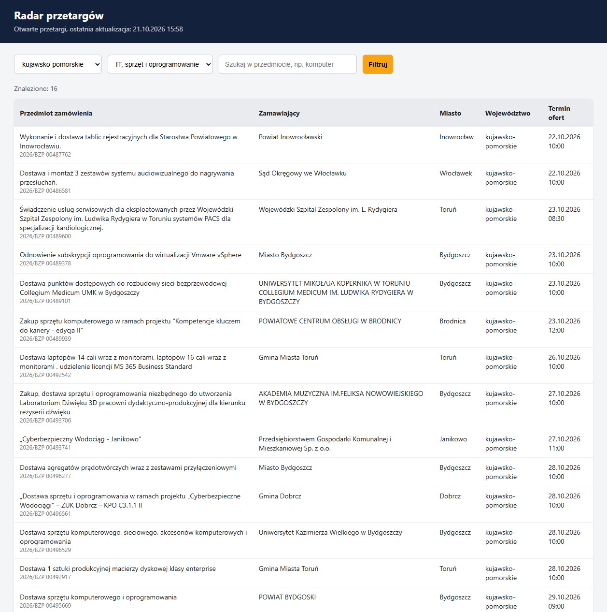
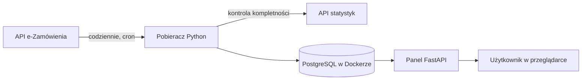

# Radar przetargów


Codziennie pobiera ogłoszenia o zamówieniach publicznych z Biuletynu Zamówień Publicznych i pozwala firmom szybko znaleźć przetargi z ich branży i regionu, zamiast ręcznie przeglądać kilkaset ogłoszeń dziennie.



## Funkcje

- Automatyczne pobieranie wszystkich ogłoszeń o zamówieniu z oficjalnego API e-Zamówienia, codziennie o 7:00.
- Kontrola kompletności: liczba pobranych ogłoszeń jest porównywana z oficjalnymi statystykami, a każda rozbieżność kończy zadanie kodem błędu.
- Zapis idempotentny: ponowne uruchomienie dla tego samego dnia nie tworzy duplikatów.
- Panel w przeglądarce z filtrami według województwa, branży (na podstawie kodów CPV) i słów w przedmiocie zamówienia.
- Widok wyłącznie otwartych przetargów, posortowanych od najbliższego terminu składania ofert.

## Architektura



## Technologie

| Obszar | Narzędzia |
| --- | --- |
| Język | Python 3.12 |
| Pobieranie danych | requests, REST API |
| Baza danych | PostgreSQL 17, psycopg 3 |
| Panel | FastAPI, Uvicorn, Jinja2 |
| Infrastruktura | Docker, Docker Compose |
| Automatyzacja | cron, logi zadań |
| System | Linux (Ubuntu 24.04) |

## Uruchomienie

Wymagania: Linux (lub WSL), Python 3.12, Docker z Docker Compose.

```bash
git clone git@github.com:makinmovess/radar-przetargow.git
cd radar-przetargow

cp .env.example .env
sed -i "s/wpisz_tu_haslo/$(openssl rand -hex 16)/" .env

docker compose up -d

python3 -m venv .venv
source .venv/bin/activate
pip install -r requirements.txt

python collector/fetch.py 2026-10-20
uvicorn app.main:app
```

Panel będzie dostępny pod adresem http://localhost:8000.

## Wnioski z pracy z API

Zachowanie API odbiega w kilku miejscach od oczekiwań, na przykład parametr daty końcowej jest wymagany, ale nie ogranicza wyników. Szczegóły i sposób obejścia opisałem w [docs/api-bzp.md](docs/api-bzp.md).

## Plan rozwoju

- [x] Pobieranie i kontrola kompletności
- [x] Baza danych w Dockerze
- [x] Panel z filtrami
- [x] Codzienna automatyzacja
- [x] Cała aplikacja w kontenerach
- [x] CI/CD w GitHub Actions z testami i skanem bezpieczeństwa
- [ ] Wdrożenie na serwer w chmurze
- [ ] Ocena dopasowania przetargu do profilu firmy przez AI
- [ ] Powiadomienia e-mail o nowych dopasowaniach
